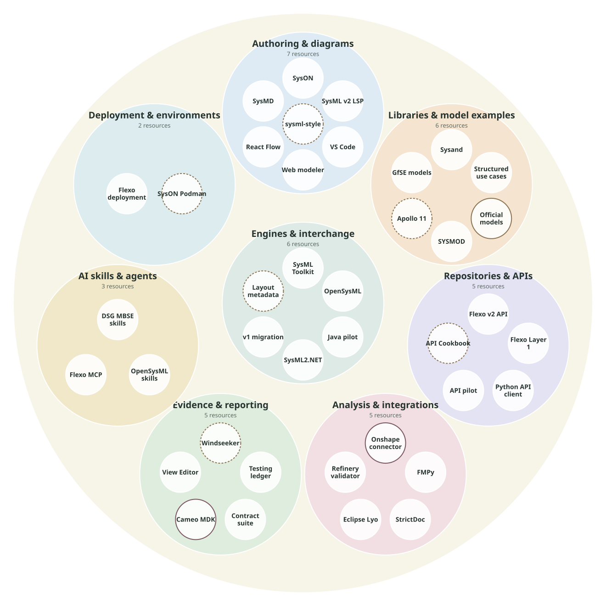

<h1>Awesome SysML v2 &amp; MBSE</h1>

A technical resource catalog for developers and systems engineers. Build models. Explore systems. Validate with evidence.

  
  
  
  

<a href="docs/resources.md">Resource notes</a> &middot; <a href="docs/coverage.md">Coverage &amp; open questions</a> &middot; <a href="CONTRIBUTING.md">Contribute</a> &middot; <a href="https://github.com/DynamicalSystemsGroup/awesome-sysmlv2-mbse/issues/new/choose">Suggest a tool or correction</a>

Find tools and utilities for **building, analyzing, and validating models** with SysML v2 and related MBSE workflows. Open-source tooling is the initial focus; commercial and mixed-license resources may be included with clear access terms.

**40 resource records** &nbsp; · &nbsp; **Primary documentation reviewed: 13 October 2026**

## About

This catalog helps developers and systems engineers discover technical tooling for SysML v2 and model-based systems engineering (MBSE). It brings together language engines, editors, diagrams, model repositories, analysis and validation utilities, integrations, and AI skills and agents.

Resources are organized by the work they support: **build, analyze and validate models**. Each entry includes source links, licensing and access requirements, interfaces, and known limitations. Open-source resources, proprietary host-dependent integrations and unresolved license terms are clearly separated.

Hosted by [Dynamical Systems Group](https://github.com/DynamicalSystemsGroup), the catalog welcomes community additions and corrections. Affiliated projects follow the same inclusion and evidence criteria as other entries. See [how to contribute](CONTRIBUTING.md), [suggest a missing resource](https://github.com/DynamicalSystemsGroup/awesome-sysmlv2-mbse/issues/new?template=suggest-resource.md), or [report an update](https://github.com/DynamicalSystemsGroup/awesome-sysmlv2-mbse/issues/new?template=update-resource.md).

## Browse by task

| Start here | Find resources for |
| --- | --- |
| [Build models](#build-models) | Editors, language servers, libraries, packages, migration and diagrams |
| [Analyze models](#analyze-models) | Queries, calculations, constraints, traceability, simulation and reports |
| [Validate models](#validate-models) | Language checks, engineering rules, automation and implementation tests |
| [AI skills and agents](#ai-skills-and-agents) | Engineering workflow skills, agent integrations and MCP tools |
| [Supporting infrastructure](#supporting-infrastructure) | Engines, SDKs, repositories, APIs, collaboration and deployment |

[Open-source resources](#open-source-tools-and-resources) · [Proprietary tools and integrations](#proprietary-tools-and-host-dependent-integrations) · [License review](#resources-awaiting-license-review) · [Standards](#standards-and-reference-material) · [Coverage and open questions](docs/coverage.md) · [Maintain this catalog](#maintain-this-catalog)

### Reading the entries

Each resource links to notes covering **purpose, interfaces, license, specification target, getting started, limitations and sources**. Entries distinguish native SysML tools from libraries, example models, deployment recipes and adjacent integration components.

> **Evidence:** Descriptions summarize upstream documentation. Tools were not installed or runtime-tested for this catalog. Compatibility and maintenance uncertainties are explicit; inclusion does not establish conformance certification.

## Ecosystem map

Explore **39 resources across eight category bubbles**, from authoring and engines to repositories, analysis, evidence and AI skills. Each resource has one primary placement; search also covers its secondary capabilities.

[Interactive bubble map](docs/diagrams/ecosystem-bubbles.html) · [Full-size SVG](docs/diagrams/ecosystem-bubbles.svg) · [Connection view](docs/diagrams/ecosystem.html) · [Scope and editable sources](docs/diagrams/README.md)

Select a category to zoom in, or a resource to inspect its purpose, license, interfaces and source links. The interactive view includes search and access filters. Circle sizes are decorative, not rankings or adoption measures; category membership does not establish interoperability.

Download the HTML and open it in a browser for the interactive view; GitHub displays its source. The separate connection view distinguishes conceptual role relationships from selected upstream-documented Flexo connections.

## Open-source tools and resources

The task tables below list resources with documented open-source licenses. Multiple open-source licenses, such as Apache-2.0 and LGPL-3.0, remain open source; check component terms in the resource notes. Integrations requiring proprietary hosts and resources awaiting license review have separate sections.

### Build models

| Category | Resources | Use |
| --- | --- | --- |
| Textual editors and language servers | [SysML Toolkit](docs/resources.md#sysml-toolkit), [OpenSysML](docs/resources.md#opensysml), [Java pilot](docs/resources.md#sysml-v2-java-pilot), [SysML v2 LSP](docs/resources.md#sysml-v2-language-server), [VS Code extension](docs/resources.md#sysml-v2-vs-code-extension) | Author models with navigation, completion and diagnostics |
| Graphical and structured editors | [Eclipse SysON](docs/resources.md#eclipse-syson), [OpenMBEE web modeler](docs/resources.md#openmbee-web-modeler), [React Flow components](docs/resources.md#sysml-react-flow-components) | Model in a browser or build a diagram interface |
| Notebook modeling | [SysMD](docs/resources.md#sysmd-notebook), [Java pilot](docs/resources.md#sysml-v2-java-pilot) | Combine model cells, calculations and documentation |
| Reusable libraries and methods | [Structured Use Cases](docs/resources.md#structured-use-cases), [SYSMOD](docs/resources.md#sysmod-library) | Reuse scenarios, requirements patterns and architecture concepts |
| Reference models | [GfSE collection](docs/resources.md#gfse-sysml-v2-model-collection) | Learn from models and select realistic evaluation inputs |
| Packages and dependencies | [Sysand](docs/resources.md#sysand) | Manage model libraries and dependencies |
| Conversion and interchange | [SysML Toolkit](docs/resources.md#sysml-toolkit), [SysML2.NET](docs/resources.md#sysml2net) | Work with model representations and project archives |
| Migration | [OpenSysML migration](docs/resources.md#opensysml-v1-migration), [OMG transformation specification](https://www.omg.org/spec/SysML/2.0/) | Investigate legacy-to-v2 mappings and migration losses |
| Editable layout and presentation | [React Flow components](docs/resources.md#sysml-react-flow-components) | Retain geometry or implement diagram layouts; cross-tool interchange remains unverified |

An image export, model conversion, or tool-specific layout extension does not by itself establish portable editable diagrams.

### Analyze models

| Category | Resources | Use |
| --- | --- | --- |
| Calculations and behavior execution | [OpenSysML](docs/resources.md#opensysml) | Evaluate values and execute supported actions and states |
| Expressions and constraint solving | [SysML Toolkit](docs/resources.md#sysml-toolkit), [SysMD](docs/resources.md#sysmd-notebook) | Evaluate expressions, units and supported constraint fragments |
| Queries and model exploration | [Python API client](docs/resources.md#openmbee-python-api-client) | Traverse decomposition and query model repositories |
| Diagrams and visualization | [Java pilot](docs/resources.md#sysml-v2-java-pilot), [SysML Toolkit](docs/resources.md#sysml-toolkit), [Eclipse SysON](docs/resources.md#eclipse-syson), [VS Code extension](docs/resources.md#sysml-v2-vs-code-extension) | Inspect models through visual views |
| Dependencies and structural metrics | [SysML v2 LSP](docs/resources.md#sysml-v2-language-server) | Inspect model complexity; general impact analysis is not established |
| Traceability and requirements | [SYSMOD](docs/resources.md#sysmod-library), [StrictDoc](docs/resources.md#strictdoc), [Eclipse Lyo](docs/resources.md#eclipse-lyo) | Model relationships or build requirements/lifecycle integrations; adjacent tools need connectors |
| CAD and simulation integration | [FMPy](docs/resources.md#fmpy) | Run FMUs; FMPy is a generic simulation component |
| Reporting and documents | [View Editor (legacy MBSE)](docs/resources.md#openmbee-view-editor), [OpenSysML](docs/resources.md#opensysml), [SysMD](docs/resources.md#sysmd-notebook) | Produce model-derived documents and notebooks |

Use the resource notes to distinguish native model processing from examples and generic integration components.

### Validate models

| Category | Resources | Use |
| --- | --- | --- |
| Syntax and semantic checks | [SysML Toolkit](docs/resources.md#sysml-toolkit), [OpenSysML](docs/resources.md#opensysml), [Java pilot](docs/resources.md#sysml-v2-java-pilot) | Investigate language diagnostics and supported checks |
| Project rules and linting | [SysML Toolkit](docs/resources.md#sysml-toolkit) | Apply supported modeling policies |
| Engineering patterns and constraints | [Refinery validator](docs/resources.md#refinery-sysml-v2-validator), [SysMD](docs/resources.md#sysmd-notebook), [SysML Toolkit](docs/resources.md#sysml-toolkit) | Check selected patterns and supported constraints; preserve undecided outcomes |
| Automated execution and CI hooks | [service contract suite](docs/resources.md#opensysml-service-contract-suite) | Use failure exit codes and machine-readable test results in workflows |
| Implementation tests and evidence | [OpenMBEE testing ledger](docs/resources.md#openmbee-sysml-v2-testing-ledger), [service contract suite](docs/resources.md#opensysml-service-contract-suite), [GfSE models](docs/resources.md#gfse-sysml-v2-model-collection) | Retain scoped observations, regression results and model inputs |

Requirement verification depends on the selected engine, model, rules and evidence. A regression suite or fixture collection is not automatically an independent conformance suite.

Keep three kinds of validation distinct:

- **Language correctness:** syntax, reference resolution, typing, and other language rules.
- **Engineering checks:** project rules, budgets, requirements, and analysis assumptions.
- **Implementation conformance:** whether a tool satisfies a particular standard obligation under a documented test scope.

A model passing a tool's checks does not establish engineering approval or complete tool conformance. An undecided result is not a pass.

### AI skills and agents

Resources for agent-assisted engineering, model authoring and tool access. These entries have documented open-source licensing; any agent platform, model provider or required backend has separate access terms.

| Category | Resources | Use |
| --- | --- | --- |
| Engineering workflow skills | [DSG MBSE agent skills](docs/resources.md#dsg-mbse-agent-skills) | Discovery, requirements, architecture, verification, traceability, research and visualization, with optional OOSEM and SysML extensions |
| Engine-specific skills | [OpenSysML agent skills](docs/resources.md#opensysml-agent-skills) | Guide an agent through model authoring and OpenSysML runtime/client workflows |
| Repository tool access | [Flexo Layer 1 MCP server](docs/resources.md#flexo-mms-layer-1-mcp-server) | Expose RDF repository queries and permitted revision operations to MCP clients |
| Language-tool integration | [SysML v2 LSP](docs/resources.md#sysml-v2-language-server) | Connect agents to documented language tooling through its MCP interface |

**Skills** supply instructions and workflow references. **MCP servers** expose callable tools. **Agent applications** coordinate a model, tools and execution; no complete autonomous MBSE agent application has been reviewed here yet. Keep generated artifacts, engine observations and engineering review decisions distinct.

### Supporting infrastructure

| Category | Resources | Use |
| --- | --- | --- |
| Engines, SDKs, and bindings | [OpenSysML](docs/resources.md#opensysml), [SysML Toolkit](docs/resources.md#sysml-toolkit), [Java pilot](docs/resources.md#sysml-v2-java-pilot), [SysML2.NET](docs/resources.md#sysml2net) | Integrate model processing into applications |
| Model repositories and API services | [Flexo MMS Layer 1](docs/resources.md#flexo-mms-layer-1), [Flexo MMS SysML v2](docs/resources.md#flexo-mms-sysml-v2-microservice), [API Services pilot](docs/resources.md#sysml-v2-api-services-pilot) | Access persisted models through REST/HTTP |
| Stakeholder portals | [View Editor (legacy MBSE)](docs/resources.md#openmbee-view-editor), [OpenMBEE web modeler](docs/resources.md#openmbee-web-modeler) | Browse model-derived documents or interact with models; check backend compatibility |
| Clients and lifecycle integrations | [Python API client](docs/resources.md#openmbee-python-api-client), [Eclipse Lyo](docs/resources.md#eclipse-lyo) | Build repository and lifecycle integrations |
| Package indexes | [Sysand](docs/resources.md#sysand) | Publish and resolve model packages |
| Collaboration and revision workflows | [Flexo MMS Layer 1](docs/resources.md#flexo-mms-layer-1), [OpenMBEE web modeler](docs/resources.md#openmbee-web-modeler), [Eclipse SysON](docs/resources.md#eclipse-syson) | Explore branches/commits and shared model interfaces; assess concurrency separately |
| Change review and diff/merge contracts | [Systems Modeling API](https://www.omg.org/spec/SystemsModelingAPI/1.0/), [LSP preview modes](docs/resources.md#sysml-v2-language-server) | Study version/change services and visual comparison; general semantic merge remains unverified |
| Deployment and development environments | [Flexo MMS deployment](docs/resources.md#flexo-mms-deployment), [API Services pilot](docs/resources.md#sysml-v2-api-services-pilot), [OpenMBEE web modeler](docs/resources.md#openmbee-web-modeler) | Set up isolated model environments |
| Evidence and provenance | [OpenMBEE testing ledger](docs/resources.md#openmbee-sysml-v2-testing-ledger), [service contract suite](docs/resources.md#opensysml-service-contract-suite) | Preserve version-bound observations and report artifacts |

Flexo Layer 1 provides RDF repository services; its SysML v2 adapter provides the modeling API, and the deployment repository supplies setup examples. View Editor belongs to the legacy Execubots ecosystem; direct Flexo or native SysML v2 compatibility remains unverified.

See [coverage and open questions](docs/coverage.md) for limits of this collection, particularly semantic merge and diagram interoperability.

## Proprietary tools and host-dependent integrations

Proprietary modeling products are listed here with their access terms and the same build/analyze/validate categories.

| Resource | Workflow | Code license | Required host/access |
| --- | --- | --- | --- |
| [Kotar](docs/resources.md#kotar) | Browser-based SysML v2 authoring, visualization, analysis and workspace management | Proprietary; free to use according to publisher | Browser; optional remote repositories and enterprise services |

These integrations have open-source code but require access to a proprietary product or service for the named workflow:

| Resource | Workflow | Code license | Required host/access |
| --- | --- | --- | --- |
| [Cameo MDK/DocGen](docs/resources.md#openmbee-cameo-mdk-and-docgen) | Legacy MBSE document generation and repository integration | Apache-2.0 plugin | Cameo/No Magic host; host terms are separate |
| [Onshape geometry connector](docs/resources.md#sysml-v2-geometry-and-onshape-connector) | CAD assembly exchange | Apache-2.0 repository | Configured Onshape access for the connector; generic geometry utilities are separate |

Commercial availability and source licensing are separate attributes. Paid support or hosting does not make open-source code proprietary, and a free account does not make a proprietary service open source.

## Resources awaiting license review

Publicly accessible source is not enough to establish an open-source license. Keep these candidates separate until the selected artifact's terms are established.

| Resource | Category | Unresolved terms |
| --- | --- | --- |
| [API Cookbook](docs/resources.md#sysml-v2-api-cookbook) | Queries and revision workflow examples | License not established in the reviewed README |
| [Apollo 11](docs/resources.md#airbus-apollo-11-reference-model) | Reference models and traceability | License identifier not established |
| [OpenSysML layout metadata](docs/resources.md#opensysml-diagram-layout-metadata) | Editable layout experiments | Extension library artifact terms need review; parent repository is Apache-2.0 |
| [Windseeker](docs/resources.md#windseeker) | Dependency ordering, reports and CI hooks | MIT in publisher metadata; license file and distribution identity need verification |
| [sysml-style](docs/resources.md#sysml-style) | Style checks and formatting | No explicit license established |
| [SysON Podman recipe](docs/resources.md#syson-podman-compose-recipe) | Development deployment | Recipe license not established; image licenses are separate |

## Standards and reference material

- [OMG SysML 2.0](https://www.omg.org/spec/SysML/2.0/): language and v1-to-v2 transformation specifications and normative artifacts.
- [OMG KerML 1.0](https://www.omg.org/spec/KerML/1.0/): the language foundation and interchange artifacts.
- [OMG Systems Modeling API and Services 1.0](https://www.omg.org/spec/SystemsModelingAPI/1.0/): model service contracts and machine-readable artifacts.
- [Official libraries and examples](docs/resources.md#official-libraries-and-examples): release-specific models and learning material; check the license for each selected artifact.

Related discovery indexes:

- [mycr0ft/awesome-sysml](https://github.com/mycr0ft/awesome-sysml)
- [jgsystemsconsulting/awesome-sysml-v2](https://github.com/jgsystemsconsulting/awesome-sysml-v2)
- [daltskin/SysML-v2-Resources](https://github.com/daltskin/SysML-v2-Resources)
- [jgsystemsconsulting/awesome-mbse](https://github.com/jgsystemsconsulting/awesome-mbse)
- [INCOSE SysML v2 learning resources](https://github.com/INCOSE/sysml-v2-wiki/blob/main/docs/learning-resources.md)

## Maintain this catalog

**Know a tool we missed, or spotted outdated information?** [Suggest a resource](https://github.com/DynamicalSystemsGroup/awesome-sysmlv2-mbse/issues/new?template=suggest-resource.md) or [report a correction](https://github.com/DynamicalSystemsGroup/awesome-sysmlv2-mbse/issues/new?template=update-resource.md). Both links open a template to help you describe the resource and cite its sources. You can also fork the repository and [open a pull request](https://github.com/DynamicalSystemsGroup/awesome-sysmlv2-mbse/compare); the PR template includes a short checklist.

The README is the browsing index; [resource notes](docs/resources.md) hold canonical entry details. Use the [entry template](docs/resource-template.md) and [contribution guide](CONTRIBUTING.md) when adding or updating a resource.

No installation or build is required: read and edit Markdown. Updates are manual; no recurring job or website is configured. Catalog licensing and a named maintenance owner remain to be settled. Linked resources retain their upstream licenses.
